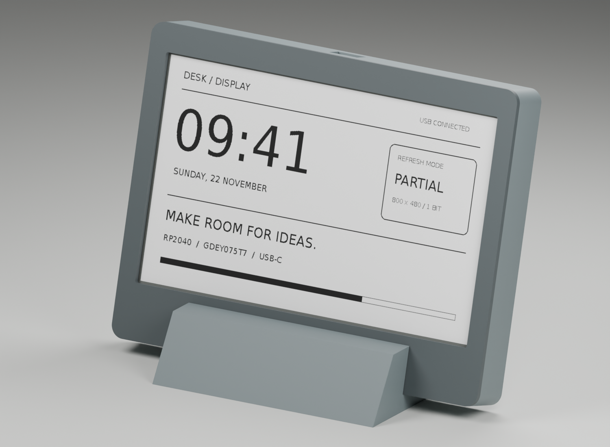

# USB-C RP2040 raw e-paper controller

A 100 × 60 mm controller PCB for the **Good Display GDEY075T7**: a **7.5-inch, 800 × 480 monochrome raw panel**. The display plugs directly into J2. USB-C provides power, USB data, and RP2040 ROM BOOTSEL programming. All display power components are on this PCB; no HAT or external driver board is required.

The panel manufacturer lists 3 s full, 1.5 s fast, and 0.3 s partial refresh at 25 °C. Actual timing depends on temperature and the panel's waveforms. This is a dashboard / text display, with periodic full refreshes to clear ghosting. The panel itself is purchased separately from the PCB assembly.

**Manufacturing status is recorded in `manufacturing/VALIDATION.md`; use that file to determine whether the fabrication release has passed its checks.**

## Hardware

- Bare RP2040 in QFN-56, including its exposed ground pad, TESTEN ground, 3.3 V I/O and 1.1 V core supply.
- Winbond W25Q16JVSNIQ, 2 MB QSPI flash.
- Raspberry Pi's recommended ABM8-272-T3 12 MHz crystal, 15 pF load capacitors, and 1 kΩ drive resistor.
- USB-C USB 2.0 device port, separate 5.1 kΩ CC resistors, 27 Ω data series resistors, USBLC6-2SC6 ESD protection, and a 500 mA resettable input fuse. This port uses USB 5 V; it does not negotiate USB PD.
- Independent 3.3 V regulators for the MCU and display. GP14 enables display power; a pulldown leaves it off during reset.
- 24-contact, 0.5 mm pitch, bottom-contact ZIF connector. Pin 1 is marked; insert the panel tail with exposed contacts facing the PCB.
- Si1308EDL boost MOSFET, 10 µH / 1 A inductor, three MBR0530 rectifiers, 0.47 Ω current sensing, and 50 V ceramic reservoir / flying capacitors.
- BOOTSEL and RESET buttons; six SWD / supply probe pads; four 3.2 mm mounting holes and three assembly fiducials.
- Two copper layers, with a ground pour on the bottom. Both layers carry routed signals and power connections. Components are assembled on the top side; reference names are on the reverse side.

## Build and inspect

```sh
bun install --frozen-lockfile
bun run typecheck
bun run check:netlist
bun run check:schematic-placement
bun run check:placement
bun run build
bun run check:shorts
bun run check:pcb-style
bun run check:continuous-style
python scripts/validate-circuit.py
```

`index.circuit.tsx` is the native product assembly entrypoint. The unchanged electronics and tscircuit routing live in `product/controller-board.tsx`; `board.circuit.tsx` selects that board for electrical and placement checks. **All PCB routing is defined and generated with tscircuit.** Five signal paths (RUN, DC, CS, BUSY and display SCK) are hand-authored in TSX with standard `trace` / `pcbPaths` primitives. The built-in local autorouter refines those paths for clearance and solves their remaining branches and all other connections. There are no imported board routes, saved-routing callbacks or externally generated vias. `tscircuit.config.ts` disables the local routing cache and cloud routing. The debug build command below records each routing stage's input and output so the result can be audited. No KiCad or external router is used to create or edit the copper.

```sh
bun run --bun tsci build index.circuit.tsx --autorouter-debug --autorouter-debug-dir dist/native-routing-release-final --autorouter-dump-srj all --autorouter-threads 1
```

The PCB uses 0.15 mm drilled vias, which add a JLCPCB fabrication charge. Complex parts were imported using `tsci import C… --jlcpcb --use-exact-footprint`; their imported footprints are in `imports/`. Solder mask, stencil apertures and reference markings are adjusted for fabrication; the USB shell slots are enlarged to 0.8 × 1.6 mm while retaining the outer board-edge clearance. Passives also use exact CLI-imported footprints with explicit LCSC codes. `docs/parts/` contains the part discovery responses; stock fields may be cached or unavailable. The previous external-routing release is superseded and excluded from current release packages.

The five authored paths use straight and 45° segments, with explicit wire landings at each via. TP6 at the board centre supplies their coordinate reference; endpoint selectors resolve the actual component pins. The crystal nets use tscircuit's built-in `bus_lanes` phase to stay short and on the top layer. The main phase receives the authored paths and the five clock paths generated earlier in the same build. Diagnostic route JSON written by the CLI is an output only; nothing in the circuit imports or replays it. `manufacturing/checks/routing-provenance.json` identifies the five source-authored inputs and their native refinements, and records hashes, solver versions and disabled caches.

The current release contains 165 traces and 151 through vias on two copper layers. Electrical, clearance, drill, Gerber-derived shorts and default PCB-style checks pass. The continuous-copper check also reports zero style findings across 238 chains. Details and tool versions are recorded in `manufacturing/VALIDATION.md`.

## Fabrication package

`manufacturing/JLCPCB-Gerbers-RevA.zip`, `BOM.csv`, and `CPL.csv` are the PCB and top-side assembly files, generated from the fresh tscircuit build. `SMT-Stencil-RevA.zip` provides the stencil. The directory also contains three schematic SVG pages, assembly and PCB views, and check reports. See `manufacturing/VALIDATION.md` for the current routing revision's release status and `ORDERING.md` for fabrication settings. The RP2040 exposed pad has four 1.15 mm stencil windows (55% paste coverage). Probe pads have no stencil openings.

To export a newly validated build, use an absolute output path (the CLI resolves relative exports beside the input file):

```sh
bun run --bun tsci export dist/index/circuit.json -f gerbers -o "$PWD/manufacturing/JLCPCB-Gerbers-RevA.zip"
python scripts/package-release.py
python scripts/validate-circuit.py
python scripts/audit-routing.py
```

## Firmware connections

**Firmware and host image sender are included.** Flash [`USB-Epaper-RevA-v1.0.0.uf2`](firmware/releases/USB-Epaper-RevA-v1.0.0.uf2), then use the Python USB sender. See [`firmware/README.md`](firmware/README.md) for BOOTSEL installation, image conversion, commands and build instructions.

```sh
python -m pip install -r firmware/host/requirements.txt
python firmware/host/epaper.py --port /dev/ttyACM0 send image.png
```

The firmware validates CRC-checked transfers, finds the changed rectangle, uses fast partial refresh after a full baseline, and runs a clean full refresh after five partial updates. The ready-built UF2 and source are included; software tests pass, while real USB and panel operation await a physical prototype.

| Function | RP2040 GPIO | Raw panel contact |
|---|---:|---:|
| SPI1 SCK | 10, via 27 Ω | 13 |
| SPI1 MOSI | 11, via 27 Ω | 14 |
| CS, active low | 9 | 12 |
| Data / command | 8 | 11 |
| Reset, active low | 12 | 10 |
| Busy input | 13 | 9 |
| Display regulator enable | 14, active high | U4 enable |

Use the **GDEY075T7 / UC8179** driver and its vendor waveforms. For GxEPD2, select `GxEPD2_750_GDEY075T7`. A monochrome framebuffer takes 48,000 bytes; two frames fit in RP2040 RAM. USB-C carries image data through application firmware; it is not a USB video / DisplayPort input.

Startup: keep display power disabled, initialize USB and the MCU, then enable the display regulator before resetting and initializing the panel. Hold SPI/control outputs low or high impedance while display power is off to avoid back-powering the panel through its inputs. Before removing display power, complete the vendor power-off sequence and wait for BUSY. Use a full refresh after at most five consecutive partial/fast updates as an initial policy; tune only after testing the actual panel. Power cycling loses the panel controller's previous-image RAM, so restore the baseline before partial refresh.

BOOTSEL: hold SW1 while pressing and releasing RESET (SW2), then release SW1. The RP2040 ROM exposes a USB mass-storage device for UF2 installation. TP4/TP5 provide SWDIO/SWCLK; TP1 is ground, TP2 is 3.3 V reference, TP3 is core voltage, and TP6 is RUN. Do not drive TP3 from an external supply.

## Sources

- [GDEY075T7 manufacturer specifications and refresh modes](https://www.good-display.com/product/396.html)
- [GDEY075T7 manufacturer datasheet download](https://www.good-display.com/companyfile/692.html), including the circuit on page 40. Reference links are collected in [`docs/reference/README.md`](docs/reference/README.md).
- [Hardware design with RP2040](https://datasheets.raspberrypi.com/rp2040/hardware-design-with-rp2040.pdf)
- [JLCPCB fabrication capabilities](https://jlcpcb.com/capabilities/pcb-capabilities)
- [JLCPCB BOM/CPL format](https://jlcpcb.com/help/article/how-to-generate-the-bom-and-centroid-file-from-kicad)

## Mechanical assembly

The printable enclosure is a **182.2 × 137.2 × 20.75 mm landscape frame** with a bezel, separate foam-supported glass carrier, rear cover and 15° desktop cradle. USB enters at the top and BOOTSEL/RESET are accessible from the rear. All four parts have STL and editable STEP files, with parametric CAD source and a nominal-fit report.

See [`enclosure/README.md`](enclosure/README.md) for printing, screw sizes, foam placement, flex-tail folding and assembly. The case has passed solid/collision and watertight-mesh checks; a first print must confirm flex insertion depth, supplied-panel tolerances and the USB plug fit. Disconnect USB before inserting or removing the FPC.



## Native assembly, System and Drawing views

Open [the published product](https://tscircuit.com/rushabhcodes/usb-c-e-paper-display). The viewer selector exposes **3D** for the assembled enclosure, **System** for the image pipeline and power tree, and **Drawing** for six engineering sheets: controller PCB, front bezel, carrier, rear cover, stand and complete product. On a narrow viewer these choices are in the dropdown beside Files/PCB/Schematic.

The entrypoint uses `assembly.device`, four `assembly.printedpart` elements and twelve `assembly.part` elements. The parts include the panel, flex tail, compliant supports and eight screws. Four native explosion stages separate the enclosure. Printed-part geometry uses native JSCAD `createGeom3` operations derived directly from the validated printable meshes, so dimensions measure the real geometry. The remaining models use immutable GLB URLs; both source geometry and models are included in the registry package. This integration follows the [official assembly documentation](https://docs.tscircuit.com/elements/assembly-device) and the [Abse Gameboy enclosure example](https://tscircuit.com/abse/gameboy-advance).

`product/system-design.tsx` declares two `systemblock.page` diagrams and links blocks to real PCB references. `product/drawings.tsx` declares six `assembly.drawing.page` sheets with dimension lines, title blocks and mechanical notes. Self-contained SVG exports are in `manufacturing/engineering/`; system diagrams are in `manufacturing/system/`.

```sh
bun scripts/render-engineering.mjs
```

The drawing export script uses the official `circuit-json-to-drawing` 0.0.7 converter, which supports board/part drawing stages. The pinned CLI's bundled drawing converter predates those stages, so use this script for the six-sheet export. Geometry is resolved from the same native circuit JSON and project models; the script only adapts source identities and the documented CAD/glTF coordinate frame.

This revision changes the product assembly and documentation; no physical prototype has been tested. Native explosion checking reports incomplete closed-geometry coverage for some imported electronic models and the panel's decorative image plane. The original solid/mesh fit report remains available in `enclosure/fit-report.json`.
