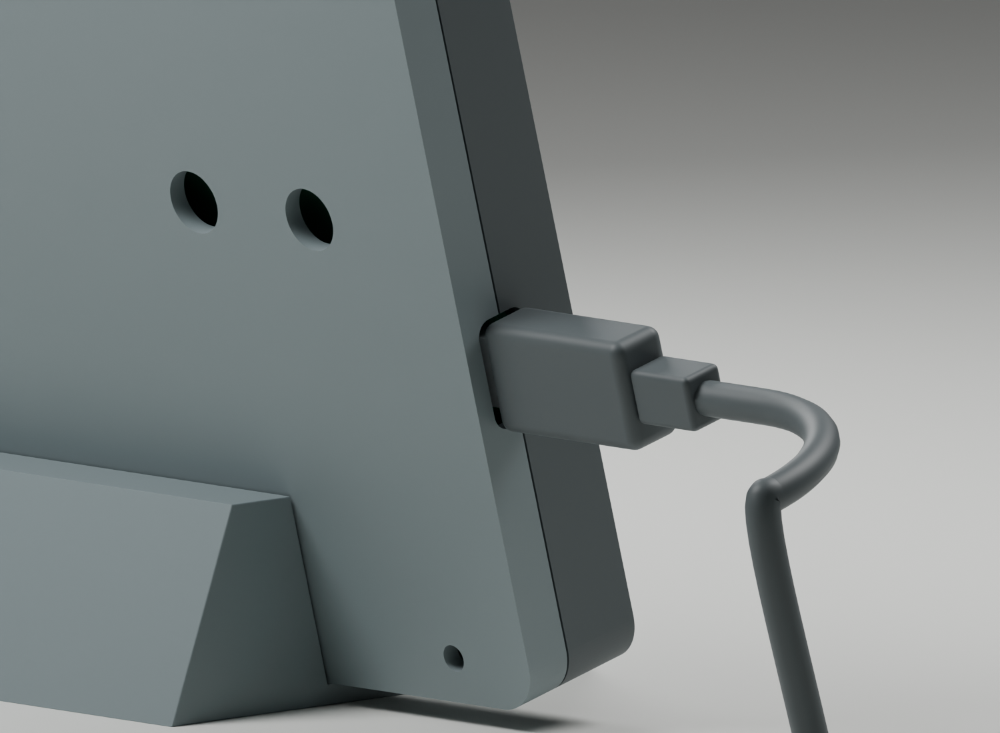

# USB-C RP2354B raw e-paper controller

A 100 × 60 mm controller PCB for the **Good Display GDEY075T7**: a **7.5-inch, 800 × 480 monochrome raw panel**. The display plugs directly into J2. USB-C provides power, USB data, and RP2354B ROM BOOTSEL programming. All display power components are on this PCB; no HAT or external driver board is required.

The panel manufacturer lists 3 s full, 1.5 s fast, and 0.3 s partial refresh at 25 °C. Actual timing depends on temperature and the panel's waveforms. This is a dashboard / text display, with periodic full refreshes to clear ghosting. The panel itself is purchased separately from the PCB assembly.

The validated Rev C PCB, firmware and 18 mm enclosure are available in [release v1.3.0](https://github.com/rushabhcodes/usb-c-e-paper-display/releases/tag/v1.3.0). The native full-product build has zero errors and warnings; Gerber shorts, default style and continuous-copper checks pass.

**Manufacturing status is recorded in `manufacturing/VALIDATION.md`; use that file to determine whether the fabrication release has passed its checks.**

## Hardware

- Bare RP2354B in QFN-80, including exposed ground pad 81, 3.3 V I/O and an external 1.092 V core buck supply.
- 2 MB stacked flash inside RP2354B; no external flash chip. U5 is now a TLV62569 core buck regulator. See [Rev C hardware details](docs/RP2354B.md).
- Raspberry Pi's recommended ABM8-272-T3 12 MHz crystal, 15 pF load capacitors, and 1 kΩ drive resistor.
- USB-C USB 2.0 device port, separate 5.1 kΩ CC resistors, 27 Ω data series resistors, USBLC6-2SC6 ESD protection, and a 500 mA resettable input fuse. This port uses USB 5 V; it does not negotiate USB PD.
- Independent 3.3 V regulators for the MCU and display. GP14 enables display power; a pulldown leaves it off during reset.
- 24-contact, 0.5 mm pitch, bottom-contact ZIF connector. Pin 1 is marked; insert the panel tail with exposed contacts facing the PCB.
- Si1308EDL boost MOSFET, 10 µH / 1 A inductor, three MBR0530 rectifiers, 0.47 Ω current sensing, and 50 V ceramic reservoir / flying capacitors.
- BOOTSEL and RESET buttons; six SWD / supply probe pads; four 3.2 mm mounting holes and three assembly fiducials.
- Four copper layers, with an inner ground pour beneath the signals. An inner1 ground pour provides a ground reference; the native router can use all four layers for signals and power. Components are assembled on the top side; 76 readable reference names are on the component-side top silkscreen.

## Build and inspect

```sh
bun install --frozen-lockfile
bun run refresh:stock
bun run typecheck
bun run check:netlist
bun run check:schematic-placement
bun run check:placement
bun run build
bun run check:shorts
bun run check:pcb-style
bun run check:continuous-style
python scripts/validate-circuit.py
```

`index.circuit.tsx` is the native product assembly entrypoint. The electronics and tscircuit routing live in `product/controller-board.tsx`; `board.circuit.tsx` selects that board for electrical and placement checks. **All PCB routing is defined and generated with tscircuit.** Local USB power, MCU bypass supplies, crystal connections, ground returns and signal escapes are authored with ordinary `trace` / `pcbPath` and `via` primitives. RP2354B uses internal flash. A source-authored bottom-layer core supply tree joins the buck output to three local DVDD bypasses, the core probe and feedback divider. BUSY uses inner2 between full-stack vias; SWD, RESET and USB are routed natively from the new pinout. TP6 sits beside the reset pull-up and button with fixed local connections. Ground pads reach the inner ground pour through short local via returns; USB shell slots already pass through that plane. The remaining named nets are explicitly assigned to the built-in local router, with implicit routing disabled. Unrouted-connection and physical checks remain enabled. The native router generates the remaining copper from the current placement. The source imports no routed-board paths and defines no routing algorithm callbacks. `tscircuit.config.ts` disables both local and cloud routing caches.
```sh
bun run --bun tsci build index.circuit.tsx --autorouter-debug --autorouter-debug-dir dist/native-routing-final-release --autorouter-dump-srj all --autorouter-threads 1
```

The pinned Core dependency has a reproducible Bun patch in `patches/`. It preserves the declared net and source endpoints on native autorouter branches instead of borrowing an unrelated local trace's identity and width. It also preserves explicitly requested inner-layer via ports, allowing ordinary traces to connect to inner2 on full-stack through vias. These fixes correct native connectivity/API behavior without changing the routing algorithm or disabling checks. `bun install --frozen-lockfile` applies it; `bun test tests` checks both the native-via regression and detection of a real foreign-net short. Keep the patch with the source when rebuilding.

The tsci download includes the helper scripts, tests, firmware, enclosure sources and fabrication inputs used by these commands. Download the entire package into an empty directory before installing; the embedded `tsci-package-manifest.json` lists the source files and SHA256 hashes. Its `package.json` hash excludes only the release version, which the CLI may increment during publication. A clean rebuild uses the commands above; Python 3 is required for the audit helpers. Firmware and enclosure regeneration additionally require the tools described in their respective READMEs.

Publish through the checked-in packaging command so helper scripts cannot be omitted by a hand-selected staging list:

```sh
python scripts/publish-tsci.py --stage-only  # inspect dist/tsci-package-* first
python scripts/publish-tsci.py               # stage and run tsci push --compress --include-dist
```

The packager copies every non-hidden Git-tracked file, verifies the validated design inputs, and records the exact source manifest. It also works from a downloaded package using that manifest when no Git checkout is present. Local toolchains, caches and untracked files are excluded.

Verify a published version with `python scripts/verify-tsci-package.py VERSION`. This downloads its source files into a new directory, checks the manifest, installs the pinned dependencies, exercises the stock and test helpers, and performs a fresh native build plus all release checks. Generated `dist` files are excluded from the download. The rebuilt PCB and CAD must match the included fabrication release.

Rev C uses four layers for RP2354B fanout and an inner ground reference. The PCB uses 0.30 mm drilled vias and 0.55 mm pads, avoiding the previous small-drill fabrication charge. Complex parts were imported using `tsci import C… --jlcpcb --use-exact-footprint`; their imported footprints are in `imports/`. Solder mask, stencil apertures and reference markings are adjusted for fabrication; the USB shell slots are enlarged to 0.8 × 1.6 mm while retaining the outer board-edge clearance. Passives also use exact CLI-imported footprints with explicit LCSC codes. `docs/parts/` contains the part discovery responses; inventory is refreshed from exact JLCPCB product records with `bun run refresh:stock`. The supplier engine retains native lookup, footprint and orientation checks; only verified inventory younger than six hours supplements an unknown catalog result. Unknown or expired inventory remains a warning. The previous external-routing release is superseded and excluded from current release packages.

The native autorouter receives the source-authored local connections and ground vias, then routes the remaining connections from the current placement. Diagnostic route JSON written by the CLI is output only. `manufacturing/checks/routing-provenance.json` records the fresh inputs, source hashes, solver versions and disabled caches.

See `manufacturing/VALIDATION.md` for measured routing counts, Gerber shorts, default PCB style and continuous-copper checks for this release.

## Fabrication package

`manufacturing/JLCPCB-Gerbers-RevC.zip`, `BOM.csv`, and `CPL.csv` are the PCB and top-side assembly files, generated from the fresh tscircuit build. `SMT-Stencil-RevC.zip` provides the stencil. The directory also contains five schematic SVG pages, assembly and PCB views, and check reports. See `manufacturing/VALIDATION.md` for the current routing revision's release status and `ORDERING.md` for fabrication settings. The RP2354B exposed pad has four 1.25 mm stencil windows (54% paste coverage). Probe pads have no stencil openings.

To export a newly validated build, use an absolute output path (the CLI resolves relative exports beside the input file):

```sh
bun run --bun tsci export dist/index/circuit.json -f gerbers -o "$PWD/manufacturing/JLCPCB-Gerbers-RevC.zip"
python scripts/package-release.py
python scripts/validate-circuit.py
python scripts/audit-routing.py
```

## Firmware connections

**Firmware and host image sender are included.** Flash [`USB-Epaper-RevC-RP2354B-v1.1.0.uf2`](firmware/releases/rp2354b/USB-Epaper-RevC-RP2354B-v1.1.0.uf2), then use the Python USB sender. See [`firmware/README.md`](firmware/README.md) for BOOTSEL installation, image conversion, commands and build instructions.

```sh
python -m venv .venv-host
.venv-host/bin/pip install -r firmware/host/requirements.txt
.venv-host/bin/python firmware/host/epaper.py --port /dev/ttyACM0 send image.png
```

Connect a normal USB-C **data cable** to the left-side socket and a computer USB host. A USB-A-to-C cable also works. Other host devices need an application implementing the included serial image protocol; a charger supplies power only.

Rev C preserves the GPIO assignments and USB protocol, but requires the new RP2354B UF2 in `firmware/releases/rp2354b/`. The archived RP2040 UF2 is incompatible with Rev C.

The firmware validates CRC-checked transfers, finds the changed rectangle, uses fast partial refresh after a full baseline, and runs a clean full refresh after five partial updates. The ready-built UF2 and source are included; software tests pass, while real USB and panel operation await a physical prototype.

| Function | RP2354B GPIO | Raw panel contact |
|---|---:|---:|
| SPI1 SCK | 10, via 27 Ω | 13 |
| SPI1 MOSI | 11, via 27 Ω | 14 |
| CS, active low | 9 | 12 |
| Data / command | 8 | 11 |
| Reset, active low | 12 | 10 |
| Busy input | 13 | 9 |
| Display regulator enable | 14, active high | U4 enable |

Use the **GDEY075T7 / UC8179** driver and its vendor waveforms. For GxEPD2, select `GxEPD2_750_GDEY075T7`. A monochrome framebuffer takes 48,000 bytes; two frames fit in RP2354B RAM. USB-C carries image data through application firmware; it is not a USB video / DisplayPort input.

Startup: keep display power disabled, initialize USB and the MCU, then enable the display regulator before resetting and initializing the panel. Hold SPI/control outputs low or high impedance while display power is off to avoid back-powering the panel through its inputs. Before removing display power, complete the vendor power-off sequence and wait for BUSY. Use a full refresh after at most five consecutive partial/fast updates as an initial policy; tune only after testing the actual panel. Power cycling loses the panel controller's previous-image RAM, so restore the baseline before partial refresh.

BOOTSEL: hold SW1 while pressing and releasing RESET (SW2), then release SW1. The RP2354B ROM exposes a USB mass-storage device for UF2 installation. TP4/TP5 provide SWDIO/SWCLK; TP1 is ground, TP2 is 3.3 V reference, TP3 is core voltage, and TP6 is RUN. Do not drive TP3 from an external supply.

## Sources

- [GDEY075T7 manufacturer specifications and refresh modes](https://www.good-display.com/product/396.html)
- [GDEY075T7 manufacturer datasheet download](https://www.good-display.com/companyfile/692.html), including the circuit on page 40. Reference links are collected in [`docs/reference/README.md`](docs/reference/README.md).
- [Hardware design with RP2354B](https://datasheets.raspberrypi.com/rp2350/hardware-design-with-rp2350.pdf)
- [JLCPCB fabrication capabilities](https://jlcpcb.com/capabilities/pcb-capabilities)
- [JLCPCB BOM/CPL format](https://jlcpcb.com/help/article/how-to-generate-the-bom-and-centroid-file-from-kicad)

## Mechanical assembly

The printable enclosure is a **182.2 × 137.2 × 18.0 mm landscape frame** with a bezel, separate foam-supported glass carrier, rear cover and 15° desktop cradle. USB-C exits the left side, above the cradle, through a small 14 × 8 mm opening. The socket mouth projects 0.2 mm past the sidewall, leaving the full plug body outside and easy to grip. BOOTSEL/RESET are accessible from the rear. The PCB sits horizontally across the lower half of the frame and the display connector remains beside the short panel tail. All four parts have STL and editable STEP files, with parametric CAD source and a nominal-fit report.

See [`enclosure/README.md`](enclosure/README.md) for printing, screw sizes, foam placement, flex-tail folding and assembly. The case has passed solid/collision and watertight-mesh checks; a first print must confirm flex insertion depth, supplied-panel tolerances and the USB plug fit. Disconnect USB before inserting or removing the FPC.


## Native assembly, System and Drawing views

Open [the published product](https://tscircuit.com/rushabhcodes/usb-c-e-paper-display). The viewer selector exposes **3D** for the assembled enclosure, **System** for the image pipeline and power tree, and **Drawing** for six engineering sheets: controller PCB, front bezel, carrier, rear cover, stand and complete product. On a narrow viewer these choices are in the dropdown beside Files/PCB/Schematic.

The entrypoint uses `assembly.device`, four `assembly.printedpart` elements and twelve `assembly.part` elements. The parts include the panel, flex tail, compliant supports and eight screws. Four native explosion stages separate the enclosure. Printed-part geometry uses native JSCAD `createGeom3` operations derived directly from the validated printable meshes, so dimensions measure the real geometry. The remaining models use immutable GLB URLs; both source geometry and models are included in the registry package. This integration follows the [official assembly documentation](https://docs.tscircuit.com/elements/assembly-device) and the [Abse Gameboy enclosure example](https://tscircuit.com/abse/gameboy-advance).

`product/system-design.tsx` declares two `systemblock.page` diagrams and links blocks to real PCB references. `product/drawings.tsx` declares six `assembly.drawing.page` sheets with dimension lines, title blocks and mechanical notes. Self-contained SVG exports are in `manufacturing/engineering/`; system diagrams are in `manufacturing/system/`.

```sh
bun scripts/render-engineering.mjs
```

The drawing export script uses the official `circuit-json-to-drawing` 0.0.7 converter, which supports board/part drawing stages. The pinned CLI's bundled drawing converter predates those stages, so use this script for the six-sheet export. Geometry is resolved from the same native circuit JSON and project models; the script only adapts source identities and the documented CAD/glTF coordinate frame.

The USB connector and large capacitor viewer models are closed solids tessellated from their original supplier STEP files; the panel image is on a closed glass model. Model geometry and installed coordinate frames are audited. No physical prototype has been tested. Nominal solid/mesh fit and complete side-plug insertion/grip checks are in `enclosure/fit-report.json` and `enclosure/usability-report.json`.


