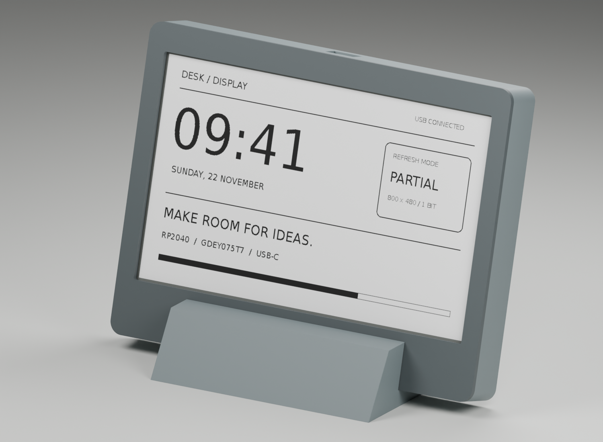
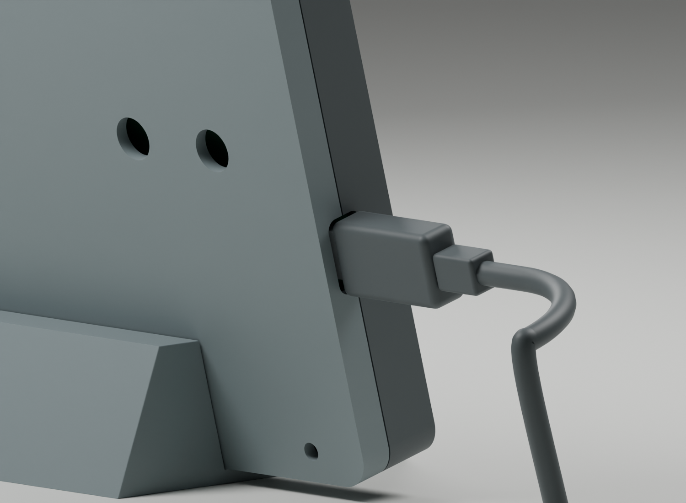
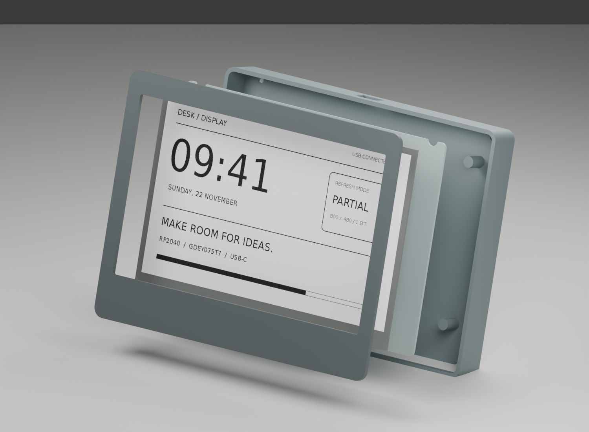

# Printable enclosure — GDEY075T7 + PCB Rev C

A landscape desk frame, **182.2 × 137.2 × 18.0 mm**, with a separate **15° desk cradle**. The raw display and all electronics are inside the case. USB-C exits flush from the left side above the stand, with rear access to BOOTSEL and RESET. The files use millimetres and are already oriented for printing.



## Print files

| File in `exports/` | Quantity | Orientation / function |
|---|---:|---|
| `front-bezel.stl` | 1 | Flat visible face down; locates the glass |
| `panel-carrier.stl` | 1 | Flat glass side down; PCB posts print upward |
| `rear-cover.stl` | 1 | Rear exterior down; cavity faces upward |
| `desk-stand.stl` | 1 | Broad base down; optional removable 15° cradle |

Matching editable STEP files, `enclosure-assembly.step`, parametric `model.py`, rendered exploded view and `fit-report.json` are included. `*-assembly.step` parts use their assembled coordinates; the other individual STEP/STL files use printing coordinates. Use a **200 × 200 mm** or larger print bed for normal brim clearance.

Suggested settings: PETG or PLA, 0.4 mm nozzle, 0.2 mm layers, 4 perimeters, 5 top/bottom layers, 25–35% infill. Use 40% for the cradle. The shell seam crosses the USB axis: both parts have open notches, so the port needs no bridge support. Keep support off the blind screw pilots and glass pocket. Tune horizontal expansion to your printer; the glass pocket has **0.5 mm clearance per side**, and printed M3 pilot holes are 2.6 mm. Deburr all surfaces facing the panel and flex. Check the first print with the unpowered parts before installing the glass.

## Hardware and soft supports

- Four **M3 × 14 mm** pan-head screws join rear cover to bezel; four **M3 × 4 mm** pan-head screws attach the PCB to the carrier. Use hand tools and preform the plastic threads before fitting the glass. Do not substitute longer PCB screws.
- Thin compliant, nonconductive foam gasket, **0.5 mm compressed thickness**, 1.5 mm wide, around the bezel's opaque glass margins.
- Rear support foam, **2 mm compressed thickness**, 1.5–2 mm wide, on the carrier at the opaque glass margins. Leave the active screen area completely unsupported and clear. Interrupt the bottom strip around the flex tail.
- Optional nonslip pads under the cradle. No heat-set inserts, adhesives on the active glass or glue on the FPC are required.

The collar contains a **171.2 × 112.2 mm** glass pocket for the nominal **170.2 × 111.2 × 1.25 mm** panel. The window is **165.2 × 99.92 mm**, centered 3.15 mm above the glass center. The carrier sits 2 mm behind the glass and does not touch the active area. Foam should just retain the panel; screws close against printed stops and must not clamp bare glass.

## Assembly

1. Check and preform all screw pilots with the case empty; remove plastic swarf. Place the bezel face down on a clean soft surface. Apply the thin front gasket only on the opaque glass perimeter.
2. Place the display face down into the pocket, with its flex tail exiting the bottom. The active area aligns with the raised window position. Keep the tail uncreased and the driver region free of pressure.
3. Attach the controller to the carrier using four M3 × 4 screws. Components face the **rear cover**, USB points **left**, and the FPC connector points **down**. The board sits horizontally across the lower left of the case. Native `(x,y)` maps to case `(x−39.95,−y−29.3)`; mounting holes are `(-45,-25), (-45,25), (45,-25), (23,25)`. The offset hole clears the flex notch.
4. Fit the rear foam to the carrier's flat glass-facing side. Fold the flex in a smooth **180° return**, through the 20 mm bottom notch, toward J2. Keep the first 3.2 mm at the glass and the last 6 mm stiffener straight. Open J2, insert the tail squarely with contacts facing the PCB, then close the latch. Confirm pin 1 and contact orientation on the actual parts before locking it.
5. Place the carrier behind the panel. Its flat side faces the foam/glass; the PCB faces you. The carrier seats against the bezel collar. Confirm that foam supports only the opaque perimeter and the flex is free in the bottom cavity.
6. Fit the rear cover. Its four internal support posts retain the carrier. Install the four M3 × 14 screws gently; the cover must close without force. Check USB and both service holes, then place the case in the cradle.

The housing separates at the USB axis, leaving the connector free when either half is removed. The seam has 0.3 mm nominal clearance. The left-side receptacle is 0.2 mm proud of the case. Its **14 × 8 mm** rounded aperture clears the socket, metal plug and small PCB tongue; the full cable overmould remains outside. The CAD checks ordinary **14 × 8 × 24 mm** and large **22 × 10 × 30 mm** straight plug bodies over the complete **40 mm insertion stroke**, plus 7 mm of finger allowance around each body. The plug and grip clear the installed 15° stand. The lower visible-window edge sits 5.27 mm above the front stand lip at its nominal installed angle. The closed top and unbroken top foam support replace the earlier rear cable well.

Use a USB **data** cable to a computer, then the image sender in `firmware/host/epaper.py`. Rear service holes are 8 mm diameter: BOOTSEL is at case X −67.95, RESET at X −47.95, both Y −10.3. Use a blunt nonconductive probe. Other USB hosts need a compatible application. The port is not a video input.



## Fit basis and limits

Dimensions come from the manufacturer's mechanical drawing on page 7 of the [GDEY075T7 datasheet](../docs/reference/README.md) and the controller outline, mounting holes and connector datums in `product/mechanical-layout.json`. The Rev C electronics use RP2354B and an external core buck supply. The PCB outline, port and mounting datums match this 18 mm housing; the release includes a supplier-mesh clearance report for the new layout. The physical board is flipped in the case, while the displayed image remains normal landscape.

The flex is only **24 ±0.3 mm long**, 12.5 mm wide, with a 6 mm stiffened end. The modeled return uses a nominal **3.65 mm bend radius**, a 3.2 mm straight neck and an 8.6 mm straight insertion run: estimated path **23.27 mm**. The FPC contact plane (6.55 mm from the rear exterior), insertion depth, panel revision and USB overmould are assumptions to confirm on the first prototype. The generous bottom cavity and open carrier notch keep plastic away from the bend. The CAD report checks nominal geometry; it does not establish connector contact orientation or tolerance-stack fit on supplied parts.

All four printable parts are single valid CAD solids and watertight STL meshes. Nominal glass and perforated PCB models have no intersection with the printed parts; assembled shell/carrier solids also have no intersection. These checks passed, but the enclosure has **not yet been printed or physically fitted**.

## Regenerate

```sh
uv venv .toolchains/cad --python 3.12
uv pip install --python .toolchains/cad/bin/python -r enclosure/requirements.txt
.toolchains/cad/bin/python enclosure/model.py
.toolchains/cad/bin/python enclosure/check-usability.py
.toolchains/cad/bin/python enclosure/viewer-assets.py
blender --background --threads 4 --python enclosure/render.py
```

The model script exports every solid, checks STL topology, validates nominal collisions, and writes `fit-report.json`. Edit the named dimensions in `model.py` to adjust printer tolerances or the actual connector height. `render.py` creates assembly illustrations from the exported geometry; the PCB illustration follows the actual shaped substrate, while electronic bodies are simplified fit references.



## Native tscircuit viewer integration

The product entrypoint references these parts through `assembly.device`, `assembly.printedpart` and `assembly.part`, including the display, flex, foam supports and fasteners. The 3D viewer has four native separation stages. System diagrams and six dimensioned drawing sheets are authored in `product/`.

Run `.toolchains/cad/bin/python enclosure/viewer-assets.py` after regenerating the printable solids. It bakes the installed case-to-PCB transform into `models/*.glb`, records alignment and source hashes in `viewer-manifest.json`, and exports the exact printed-part triangle solids as native `createGeom3` JSCAD operations in `native-solids.json`. The physical PCB stays in its fabrication coordinates. No routing is imported by these mechanical assets.
